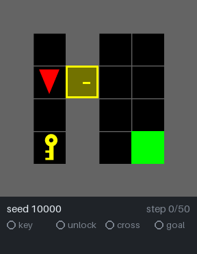
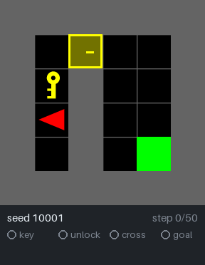
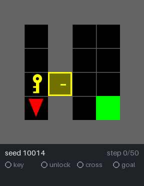
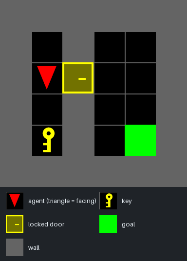
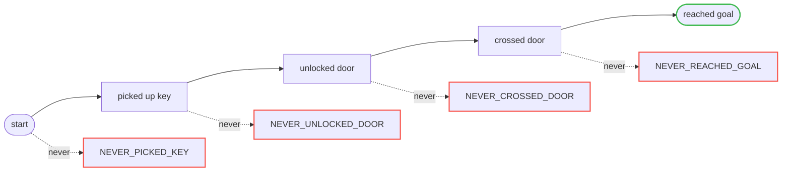

# failure-taxonomy-harness

**A success rate tells you *that* a policy failed, not *where*.** This harness
takes a behavioral-cloning (BC) policy on a multi-stage gridworld task
(`MiniGrid-DoorKey-6x6-v0`: get the key, unlock the door, go through it, reach
the goal) and automatically labels every failed episode with the stage it broke
down at, using only state the environment exposes — no human video review.

- **Approach:** milestone predicates keyed on state transitions (never on the
  action issued), recorded as first-occurrence step indices, feeding a
  precedence classifier: the first milestone never reached is the failure class.
- **Result** (one run, 50 held-out seeds): 52% success. Of the 24 failures, 83%
  never picked up the key and 17% never unlocked the door — the policy breaks
  down early, which the bare 52% hides.
- **Validation:** classes are total and mutually exclusive by construction,
  unit-tested against hand-built trajectories, and spot-checked against manual
  inspection of real episodes.

<table>
  <tr>
    <td align="center"></td>
    <td align="center"></td>
    <td align="center"></td>
  </tr>
  <tr>
    <td align="center"><b>Success</b><br>all four milestones in 13 steps</td>
    <td align="center"><b><code>NEVER_PICKED_KEY</code></b><br>times out without the key</td>
    <td align="center"><b><code>NEVER_UNLOCKED_DOOR</code></b><br>has the key, never opens the door</td>
  </tr>
</table>

Real rollouts of the trained policy on eval seeds. Each dot lights up on the
step its milestone is first reached; the first dot that never lights up is the
episode's failure class.

## How it works



The agent must pick up the key, use it to unlock the door in the dividing wall,
walk through, and reach the goal, all within 50 steps. Each stage is a
precondition for the next, so a failed episode is classified by the first
milestone it never reached:



Milestones are the **first step** each one happened, detected from state
transitions rather than from the action the policy issued. So dropping the key
or re-closing the door later doesn't erase progress, and pressing `pickup` in
front of an empty tile doesn't count as picking anything up.

See [`failure_spec.md`](failure_spec.md) for the frozen problem spec
(environment setup, failure taxonomy, and classification rules).

## Setup

```bash
uv sync
```

## Usage

The pipeline has three stages, each a standalone script:

**1. Generate expert demonstrations.** Plans each demo seed with the BFS planner
(`src/failure_taxonomy_harness/planner.py`) and replays it in the real env, writing
one `(obs, action)` JSONL file per seed to `data/demos/`.

```bash
uv run python scripts/generate_demos.py
```

**2. Train the (deliberately weakened) BC policy.** A single-hidden-layer MLP,
tuned via `--num-epochs` to land in the 40-60% success band that failure_spec.md
§3 specifies — the policy is a fixture for the classifier to exercise, not the
point of the project. Writes a checkpoint to `models/bc_policy.pt`.

```bash
uv run python scripts/train_bc.py
```

**3. Roll out on the eval seeds and classify every failure.** Runs the trained
policy on the eval seeds, records each episode's full trajectory, and assigns
every failed episode a failure class (§5) via `predicates.py` + `classifier.py`.
Writes per-step JSONL trajectories and a per-episode CSV to `data/eval/`.

```bash
uv run python scripts/record_eval.py
```

Example output from a run (exact numbers vary run to run — training isn't seeded,
so success rate is only guaranteed to land in the 40-60% band, not at this exact
value):

```
success_rate=52.00% (26/50)
failure_class_distribution (24 failed / 50 total, % of failed episodes):
  NEVER_PICKED_KEY        20  (83.3%)
  NEVER_UNLOCKED_DOOR      4  (16.7%)
  NEVER_CROSSED_DOOR       0  (0.0%)
  NEVER_REACHED_GOAL       0  (0.0%)
```

**Rebuild the README visuals (optional).** Replays recorded episodes from
`data/eval/` (one success plus one failure per class that occurred, by default)
and writes the GIFs and the annotated layout to `docs/assets/`. It needs
Pillow, which is in the optional `viz` dependency group.

```bash
uv run --group viz python scripts/render_readme_assets.py
```

## Manual play

`scripts/manual_control.py` drives the env with your own keyboard input instead
of a trained policy — useful for building intuition about a seed's layout or
spot-checking the environment facts §2 documents.

```bash
uv run python scripts/manual_control.py --seed 31
```

Arrow keys turn/move forward; `space` toggles the door; `pageup`/`tab` pick up
and `pagedown`/`left shift` drop; `backspace` resets the episode; `escape`
closes the window and quits. `enter` issues the `done` action, which per §2
is a no-op that does **not** end the episode -- reaching the goal or timing
out does, and both auto-reset to a fresh episode of the same seed.

Add `--print-obs` to also print the observation's object/colour grids and
per-step reward to the terminal, or `--full-obs` to print the
fully-observable grid `env.py` uses (§2) instead of the agent's default
partial view.

## Project structure

- `src/failure_taxonomy_harness/` — env setup, BFS planner, BC model, predicates,
  and the classifier itself (a pure function: trajectory in, failure class out —
  no env calls, no I/O, unit-testable against synthetic trajectories alone).
- `scripts/` — CLI entry points for the three pipeline stages above, plus
  `planner_audit.py` (seed-collision audit), `replay_seed.py` (manual
  hand-verification against the real env), and `render_readme_assets.py`
  (the visuals above).
- `docs/assets/` — the generated README GIFs and layout image.
- `tests/` — hand-authored predicate/classifier fixtures (§11), each replay-checked
  against a real seed rather than an assumed layout.

## Testing

```bash
uv run pytest
```
